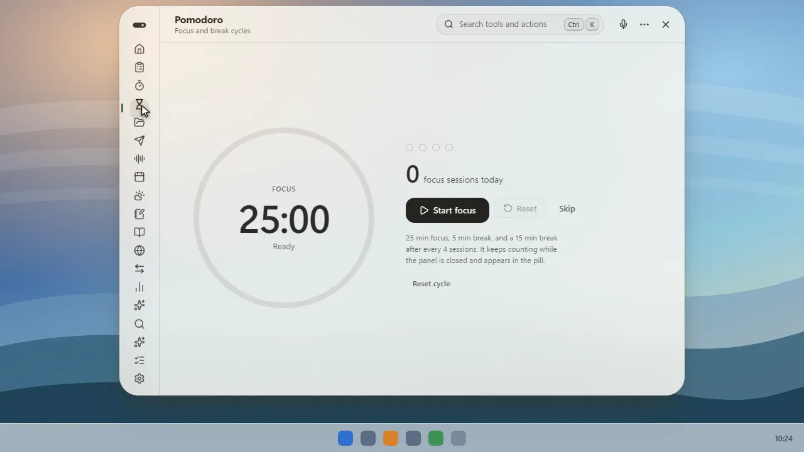
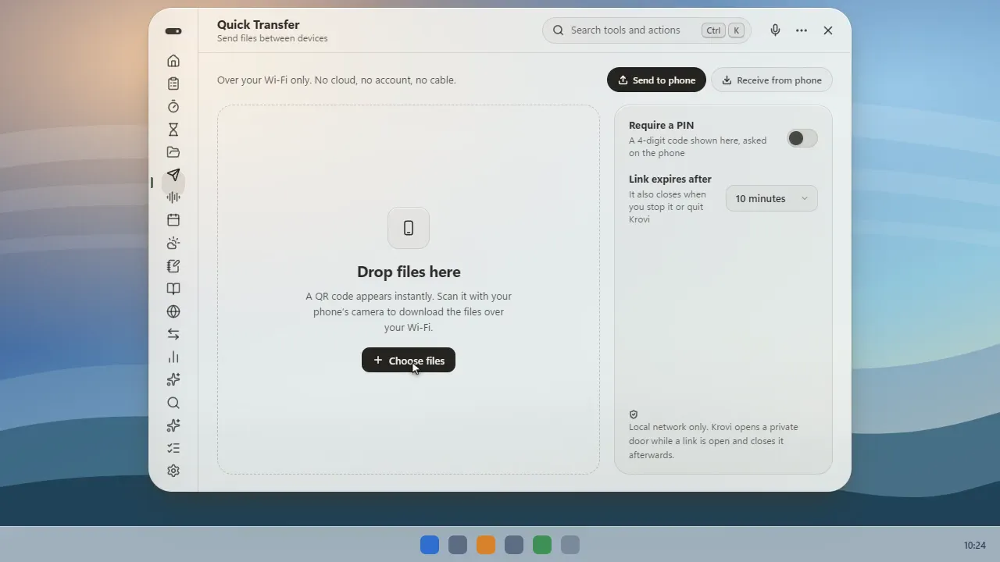
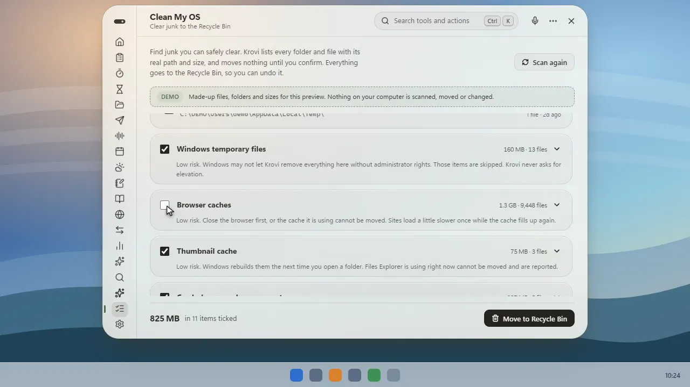

# FlowDesk

FlowDesk is a Windows desktop app that brings Krovi's productivity tools together with screen capture, screen recording, and on-device meeting transcription.

## Download and install (Windows 10/11)

FlowDesk supports Windows 10 build 19041 or later and Windows 11.

You do **not** need Node.js, Rust, Python, or other developer tools to install the ready-made app.

1. Open the [Windows installer download page](https://github.com/raghav788/FlowDesk/actions/runs/42637196593#artifacts).
2. Under **Artifacts**, click **flowdesk-windows-installers**. GitHub may ask you to sign in.
3. When the ZIP finishes downloading, right-click it in File Explorer and choose **Extract All**.
4. Open the extracted folder and double-click **FlowDesk_0.3.0_x64-setup.exe**. Follow the installer prompts. (The `.msi` file is an alternate installer.)
5. Open **FlowDesk** from the Windows Start menu.

The ZIP is large (about 721 MB) because it includes the local speech runtime and Whisper model.

## Quick start

### Open the panel

Press **Ctrl + Alt + Space**. The shortcut can be changed in Settings. Use the search box at the top or the icons along the left side to open a tool.

### Take a screenshot

Press **Ctrl + Alt + S** and select the part of the screen you want. You can also open **Capture** and choose **Select area**. The screenshot appears in the Capture library.

### Record your screen or transcribe speech

1. Open **Capture** in the panel.
2. For a video, choose **Record screen**. For a live transcript without a video, choose **Start listening**.
3. Select the audio source: **Computer**, **Microphone**, **Both**, or **Silent**.
4. Stop the recording or listening when you are done. Open an item in the library to preview a screenshot/video or read a transcript.

Transcription runs on your device. FlowDesk does not send the audio to a transcription server.

### Find your saved files

Screenshots, recordings, and transcripts are in **Documents → FlowDesk Library**. They stay there if you reinstall the app.

## What is included?

### Capture and transcription

- Area screenshots and screen recordings
- Computer audio and microphone selection
- Live, on-device Whisper transcription
- Searchable saved captures and transcripts
- In-panel image and video previews

### Krovi productivity tools

Open these from the panel's left-side tool list:

- Clipboard history, Notes, File Shelf, and Quick Transfer
- Timers and Pomodoro focus sessions
- Calendar and reminders, Weather, and Media controls
- Explain/read aloud, World Clocks, and Convert
- Screen Time, Circle to Ask, Clean My OS, Agent, and Extras

Some features need an internet connection. Optional AI tools require you to configure an AI provider key before use.

### Screenshots of Krovi features

These example screenshots come from the Krovi project whose tools are included in FlowDesk. They show feature screens and may look different from your live data or settings.

#### Pomodoro focus

#### Quick Transfer

#### Clean My OS review

## Privacy and feature notes

- Speech transcription is processed locally on your computer.
- Captures and transcripts are stored in your Documents folder.
- Krovi's existing tools are inherited from the upstream project; see [`docs/product/FEATURE_AUDIT.md`](docs/product/FEATURE_AUDIT.md) for known caveats.

## Build from source (developers only)

If you only want to use FlowDesk, follow **Download and install** above. Building from source requires Node.js 20+, Rust with the MSVC toolchain, Visual Studio Build Tools with C++ desktop support, .NET 10 SDK, and Python 3.12 x64. The GitHub Actions **Windows build** workflow assembles the local speech runtime and installer.

## Credits and licenses

FlowDesk incorporates the MIT-licensed Krovi project by Naitik Sahu and contributors ([upstream repository](https://github.com/nAItiklearn/krovi)). The capture engine is derived from ShareX and distributed under GPL-3.0; its modified source is included in `integrations/CaptureFlow-Source`. See `THIRD-PARTY-NOTICES.md` and the included licenses.
